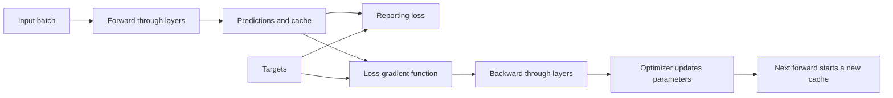

# Architecture and execution

[Documentation index](README.md) · [API reference](api.md) · [Layer guides](layers/README.md)

This guide follows one training step through the library: how a model stores its layers, how a
forward pass turns input into predictions, how backward pass turns a loss gradient into
parameter gradients, and how the optimizer applies them.

## Code organization

The entire library lives in [`lib/neurality.py`](../lib/neurality.py). `Neurality` is a single
class containing nested namespaces:

| Namespace | Purpose |
|---|---|
| `N.Backends` | `PYTHON` and `NUMPY` enum values |
| `N.Math` | Shape checks, array conversion, elementwise operations, matrix multiplication, reshaping |
| `N.Activations` | Forward activation functions |
| `N.Derivations` | Derivatives of the built-in activations |
| `N.Initializations` | Weight initializers |
| `N.Loss` | Reporting losses |
| `N.Gradients` | Gradients with respect to model output |
| `N.Optimizers` | SGD, Momentum, RMSprop, Adam |

There is no module-level `neurality.Backends` or `neurality.Optimizers`. Import the class and
use the nested attributes.

## Model representation

A model has two views of its architecture:

- `model.layers` is the ordered execution plan. Every layer is a dictionary with a `type`,
  its configuration, and its parameters. The list is the source of truth for forward and
  backward passes.
- `model.perceptrons` contains only dense neuron lists. It exists because dense layers store
  their parameters per neuron. Sequence models cannot be described from this attribute alone;
  use `model.layers` when inspecting them.

A dense neuron stores:

```python
{
    "w": [...],   # one weight vector of length fan_in
    "b": 0.0,     # finite scalar bias
    "f": ...,     # activation callable
    "df": ...,    # derivative callable, evaluated on preactivations
    "id": "P-0-3"
}
```

Dense layer parameters are stored per neuron and stacked into a matrix only when a forward or
backward pass needs one. Sequence-layer parameters (`weights`, `Wq`, `Wk`, `Wv`, `Wo`, `gamma`,
`beta`) are stored directly on the layer dictionary.

`model.layers` is built in insertion order. There is no graph compiler, no topological sort,
and no implicit branching: execution follows the list from start to end, with the residual stack
handling skip connections.

## End-to-end data flow



The reporting loss and the gradient function are separate calls. `forward()` never computes a
loss, and `backward()` never returns one. A typical iteration is

```python
prediction = model.forward(batch)
loss = N.Loss.loss_bce(prediction, targets)      # reporting only
model.backward(targets, N.Gradients.gradient_bce)  # gradients + update
```

`backward()` computes gradients and immediately updates parameters. It does not accumulate
gradients across calls, so each update needs a fresh forward pass.

## Tensor conventions

Forward accepts a 1D vector, a 2D matrix, or a 3D batch of sequences:

| Input | Interpretation |
|---|---|
| $(D,)$ | One sample; promoted to $(1,D)$ |
| $(B,D)$ | Batch of $B$ samples |
| $(B,T,D)$ | Batch of $B$ sequences of length $T$ |

For non-embedding models, the last dimension must equal `model.INPUT_SIZE`. For embedding
models, the input contains token IDs and must be 2D: $(T,)$ is promoted to $(1,T)$, and
$(B,T)$ is a batch of sequences.

Internally, dense and normalization layers flatten all leading dimensions into a row matrix:

$$
R = \prod_{i=1}^{\text{rank}-1} \text{shape}_i,
\qquad
X \in \mathbb{R}^{R \times D}.
$$

Results are restored to the original leading shape afterward. Parameters are therefore shared
across batch items and sequence positions.

Attention is the exception: it treats a 2D feature matrix as one sequence and a 3D tensor as a
batch of independent sequences. Sequence positions interact through the attention matrix, not
through a row-flattening reshape.

The symbol $R$ in the loss and gradient guides always means this flattened row count. $E$ is
the total number of scalar output elements.

## Backends and the Math adapter

Neurality supports two interchangeable backends: the native Python backend (nested lists,
standard library only) and the NumPy backend (floating-point arrays). The full comparison,
selection rules, runtime conversion, and parity notes are in [backends](backends.md).

`N.Math` provides a small common interface over nested Python lists and NumPy arrays:

| Operation | Role |
|---|---|
| `shape`, `flatten`, `tolist` | Inspect and convert values |
| `array(value, backend)` | Copy into the selected representation |
| `reshape`, `rows` | Flatten leading dimensions and restore them |
| `matmul`, `transpose` | Matrix operations |
| `add`, `sub`, `mul`, `div`, `square`, `sqrt` | Elementwise operations |
| `unary`, `binary` | Apply scalar functions recursively |
| `mean`, `finite` | Reduction and validation |

The adapter is not a complete NumPy replacement. In particular, NumPy broadcasts operands
while the pure-Python path raises on unequal list shapes. Supply targets with exact shapes and
expect small floating-point differences.

Pure Python uses nested lists and the standard library `random` generator. NumPy uses
floating-point arrays and `numpy.random`. Some NumPy code paths still loop in Python, so
selecting NumPy does not guarantee vectorized execution of every operation.

Choose the backend explicitly when NumPy may be absent:

```python
model = N(backend=N.Backends.PYTHON)
```

`N()` tries to import NumPy immediately. Calling `model.backend(...)` afterward cannot rescue a
model that failed to construct.

## Forward pass

`forward(data, padding_mask=None)` performs these steps:

1. Convert input to the model backend and promote a 1D vector to a 2D batch.
2. Validate rank, non-emptiness, finiteness, and feature width (or token-ID rank for embedding
   models).
3. Validate `padding_mask` if supplied.
4. Reset `layer_inputs`, `layer_linear`, and `_caches`.
5. Execute each layer in `model.layers`, appending its input, linear cache, and layer-specific
   cache.
6. Store the result in `model.output` and return it.

Each layer's forward map has the general form

$$
a^{(l)} = F_l\!\left(a^{(l-1)}\right),
$$

where $a^{(0)}$ is the input batch. Most layers preserve the leading shape $(B,T)$ and
transform only the feature axis; dense layers may change $D$ to $C$.

The forward pass also records everything backward needs: dense preactivations, token IDs,
normalization statistics, attention probabilities, and residual boundaries. A later forward call
replaces all of it.

## Backward pass

`backward(target, gradient_function, learning_rate=None)` starts from the gradient of the loss
with respect to the model output. Let $p$ be the prediction and $y$ the target. The supplied
function represents

$$
dA_{\text{out}} = \frac{\partial L}{\partial p},
$$

not the gradient with respect to logits. It receives flattened rows of shape $(R,C)$ and must
return the same shape. Built-in gradient functions already include the loss reduction factor.

Backward then applies the chain rule from the last layer to the first:

$$
dA^{(l-1)} = \left(\frac{\partial a^{(l)}}{\partial a^{(l-1)}}\right)^\top dA^{(l)}.
$$

For a layer with parameters $\theta_l$, the pass accumulates

$$
d\theta_l = \frac{\partial L}{\partial \theta_l}
$$

and appends `(key, layer_or_neuron, field, gradient)` entries to a parameter list. After the
whole reverse traversal, the optimizer applies every entry. Gradients are not exposed through a
public API and are not accumulated between calls.

Layer-specific backward rules are documented on each layer page:

- [Dense](layers/dense.md)
- [Embedding](layers/embedding.md)
- [Positional embedding](layers/positional-embedding.md)
- [Attention](layers/attention.md)
- [Multi-head attention](layers/multihead-attention.md)
- [Layer normalization](layers/normalization.md)
- [Residual connections](layers/residual.md)

### Residual routing

`residual_start()` pushes its input tensor onto a stack. `residual_end()` pops the
corresponding tensor and adds it to the branch output:

$$
y = F(x) + x.
$$

Backward sends the output gradient along both paths. At the matching `residual_start`, the
branch gradient and the identity gradient are added:

$$
dx = dF + dy.
$$

Nested pairs use the same stack. Feature widths at construction and complete tensor shapes at
forward time must match. Residual markers have no trainable parameters.

## Optimizer step

After backward has collected all parameter gradients, the optimizer iterates over them and
updates each parameter in place:

$$
\theta \leftarrow \theta - \eta\, u(g),
$$

where $g$ is the parameter gradient, $\eta$ the learning rate, and $u$ the optimizer-specific
direction. All gradients are computed from the same forward pass before any parameter changes,
so the update is a genuine gradient step rather than a mixture of old and new parameters.

`backward(..., learning_rate=...)` overrides the rate for that one update only. The model's
configured optimizer keeps its own rate.

See [optimizers](optimizers.md) for the direction $u$ of each algorithm and the state
lifecycle.

## Cache lifecycle

The forward cache lives on the model:

| Attribute | Contents |
|---|---|
| `output` | Last prediction |
| `layer_inputs` | Input tensor at every layer |
| `layer_linear` | Dense preactivations (or `None`) |
| `_caches` | Layer-specific intermediates used by backward |

Rules that follow from this design:

- Call `forward()` before `backward()`. Otherwise backward raises `Call forward before backward`.
- Do not run a validation or inference forward between a training forward and its backward.
  The second forward overwrites the cache used by the update.
- After an optimizer update, run forward again before the next backward.
- `model.backend(...)` clears `output`, `layer_inputs`, `layer_linear`, and `_caches`, and resets
  optimizer state. Avoid switching backends inside a training loop.
- `model.optimizer(...)` resets accumulated moments and step counters but does not clear the
  forward cache.

## Validation layers

Validation happens at several points rather than in a separate schema layer:

| Stage | Examples of checks |
|---|---|
| Construction | Positive layer sizes, callable activation/initializer, finite bias, matching residual widths, head count divides width, valid epsilon |
| `fit()` | Rank 2 or 3, non-empty, finite data |
| `forward()` | Rank and feature width, finite data, integral token IDs in range, mask shape and binary values, positional capacity, residual shape equality |
| `backward()` | Forward cache exists, target element count matches output, gradient callback returns the output shape |
| `save()` | Balanced residual pairs, serializable activations, round-trip through the loader, finite JSON values |
| `load()` | Format/version, positive input width, supported layer types, parameter shapes and finite values, configuration consistency |

Errors are raised as `ValueError` (or `TypeError` for wrong argument kinds). The loader wraps
malformed structures with an `Invalid Neurality model file` prefix.

## Memory and complexity

Dense layers cost $O(RDC)$ time and $O(RD + RC)$ memory for the forward cache. Attention is
quadratic in sequence length:

- Single-head scores: $O(T^2)$.
- Multi-head scores: $O(BHT^2)$ across a batch.
- Backward keeps probabilities, queries, keys, and values for every sequence.

Long contexts can therefore dominate both time and memory even when $D$ is small. There is no
chunked attention, sparse attention, or KV cache.

## Related guides

- [API reference](api.md) for exact signatures and defaults
- [Training and evaluation](training.md) for loops and cache discipline in practice
- [Serialization](serialization.md) for what a saved model does and does not contain