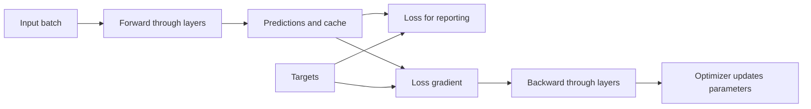

# Architecture and mathematics

[Documentation index](README.md)

## Code organization

The library lives in one file, `lib/neurality.py`. `Neurality` contains nested classes for `Math`, `Backends`, `Activations`, `Derivations`, `Initializations`, `Loss`, `Gradients`, and `Optimizers`.

`model.layers` is the ordered execution plan. Each layer is a dictionary containing its `type`, configuration, and parameters. `model.perceptrons` contains only dense neuron lists, so it does not describe the complete architecture of a sequence model. A dense neuron stores its weight vector `w`, scalar bias `b`, activation `f`, derivative `df`, and identifier `id`.

The `Math` adapter provides shape checks, conversions, elementwise operations, matrix multiplication, and reshaping. Pure Python uses nested lists; NumPy uses floating-point arrays. Some NumPy paths still execute Python loops, so the backend does not imply that every operation is vectorized.



The reporting loss and gradient function are separate calls. `backward()` computes gradients and immediately updates parameters; it is not a gradient-accumulation-only API.

## Dense layers

For `X` of shape `(R,D)`, conceptual weights `W` of shape `(D,C)`, and bias `b` of shape `(C,)`:

```text
Z = X W + b
A = f(Z)
dZ = dA ⊙ f'(Z)
dW = Xᵀ dZ
db = sum_rows(dZ)
dX = dZ Wᵀ
```

The implementation stores one vector per output neuron and stacks those vectors as columns for matrix operations. For sequence tensors, it flattens the leading dimensions into rows and restores them afterward. Parameters are shared across sequence positions.

### Activations

| Activation | Definition |
|---|---|
| Linear | `x` |
| ReLU | `max(0,x)` |
| Leaky ReLU | `x` for positive inputs, otherwise `0.01*x` |
| Sigmoid | `1/(1+exp(-x))`, evaluated using a stable sign-dependent form |
| Tanh | `tanh(x)` |
| GELU | `0.5*x*(1+tanh(sqrt(2/pi)*(x+0.044715*x³)))` |
| Softmax | `exp(z_i-max(z)) / sum_j exp(z_j-max(z))` per row |

GELU and its derivative use the tanh approximation. Softmax has Jacobian `J_ij = p_i*(δ_ij-p_j)`. Backward includes cross-class interactions, rather than multiplying only by the Jacobian diagonal. For a gradient vector `g`, the Jacobian product is `p ⊙ (g - sum(p ⊙ g))`.

## Losses and gradient scaling

Let `E` be the total number of output elements and `R` the number of output rows after flattening batch/sequence dimensions:

```text
MSE = sum((p-y)²) / E
BCE = -sum(y*log(p) + (1-y)*log(1-p)) / E
CCE = -sum_rows(sum_classes(y*log(p))) / R
```

BCE clips probabilities to `[1e-8,1-1e-8]`; CCE uses `[1e-8,1]` for logarithms and divisions. These bounds stabilize numerical evaluation. Built-in gradients already include averaging factors; parameter gradients must not be divided by the batch size again.

When the final layer uses the built-in softmax and `backward()` receives exactly `N.Gradients.gradient_cce`, the implementation uses the combined derivative:

```text
dZ = (p * sum_classes(y) - y) / R
```

For normalized target distributions, this reduces to `(p-y)/R`. Passing a wrapper around `gradient_cce` uses the general softmax path instead.

## Token and positional embeddings

Token embeddings form a trainable table `(V,D)`. Index lookup maps `(B,T)` IDs to `(B,T,D)` features. Backward adds contributions from every occurrence of a token to the same table row. There is no gradient with respect to discrete token IDs.

Learned positional embeddings form a table `(max_length,D)`. The position vector is added to each token feature vector. Gradients at the same position are summed over the batch. Every forward call numbers positions from zero; there is no position-offset argument.

## Self-attention

For one sequence `X` of shape `(T,D)` and key width `K`:

```text
Q = X Wq                  Wq: (D,K)
Kmat = X Wk               Wk: (D,K)
Vmat = X Wv               Wv: (D,D)
S = Q Kmatᵀ / sqrt(K)     S: (T,T)
P = masked_softmax(S)
O = P Vmat                O: (T,D)
```

Single-head attention has no separate output projection. Multi-head attention learns four `(D,D)` matrices: `Wq`, `Wk`, `Wv`, and `Wo`. Q/K/V are split into `H` heads of width `D/H`; each head uses scale `sqrt(D/H)`. Head outputs are concatenated and multiplied by `Wo`.

In backward, `dV = Pᵀ dO` and `dP = dO Vᵀ`. The softmax Jacobian product gives score gradients, including the attention scale. Query/key gradients then produce projection gradients and input gradients. Multi-head backward also differentiates the output projection and joins the head gradients. Projection gradients accumulate across sequences before the optimizer step.

Scores and probabilities have quadratic sequence dimensions. Multi-head score storage grows on the order of `B*H*T²`; long contexts can be expensive even for small embedding widths.

## Layer normalization

For each sample or token, normalization operates along the final feature dimension:

```text
mean = sum(x) / D
variance = sum((x-mean)²) / D
xhat = (x-mean) / sqrt(variance+epsilon)
y = gamma ⊙ xhat + beta
```

`gamma` starts at one and `beta` at zero. Both are trainable. Variance uses divisor `D`, not a sample-variance correction. No running statistics or separate inference mode are needed.

## Residual connections

`residual_start()` pushes its input onto a stack. `residual_end()` pops the corresponding value and adds it to the branch output. Nested pairs are supported. Full tensor shapes must agree.

Backward sends the output gradient along both the branch and the identity path. At the start of the residual region, the two contributions are added. Residual markers have no trainable parameters.

## Optimizer equations

For gradient `g`, learning rate `η`, and parameter `θ`:

| Optimizer | Update direction |
|---|---|
| SGD | `g` |
| Momentum | `v = momentum*v + g` |
| RMSprop | `s = rho*s + (1-rho)*g²`; direction `g/(sqrt(s)+epsilon)` |
| Adam | First and second exponential moments, corrected by `1-beta1^step` and `1-beta2^step`; direction `mhat/(sqrt(vhat)+epsilon)` |

Every update applies `θ = θ - η*direction`. All parameter gradients are collected before the optimizer updates weights. Adam increments its step counter once per backward update, rather than once per parameter.

## Cache lifecycle

Forward caches include layer inputs, dense preactivations, token indices, normalization statistics, and attention intermediates. A later forward replaces those caches. After an update, run forward again before the next backward step. Switching backend resets optimizer state and clears the forward cache.
